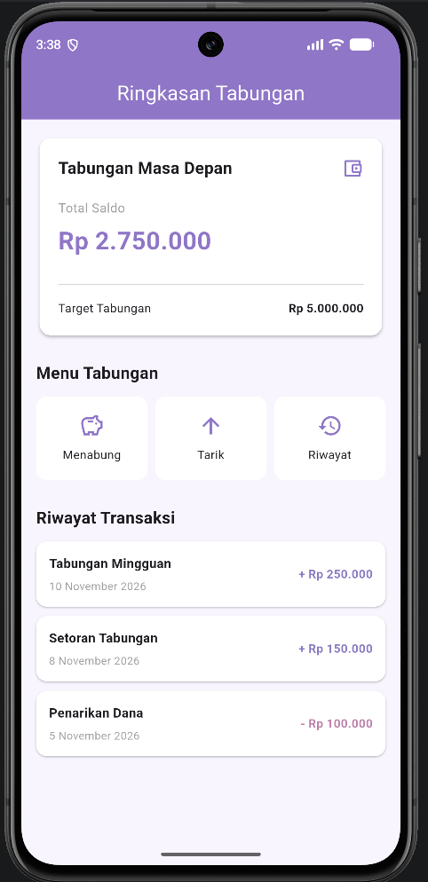
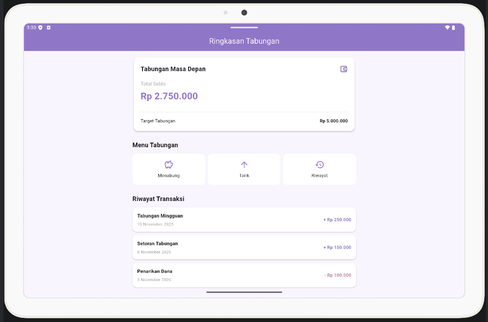

# TabungKu – Tugas Pertemuan 3 Pemrograman Mobile (TalentPath)


## Deskripsi Proyek

**TabungKu** merupakan aplikasi sederhana berbasis Flutter yang dikembangkan untuk memenuhi **Tugas Pertemuan 3 Mata Kuliah Pemrograman Mobile**. Tugas ini berfokus pada penyusunan tata letak (*layout*) halaman Ringkasan Tabungan menggunakan widget dasar Flutter.

Aplikasi menampilkan informasi saldo dan target tabungan, menu kategori, serta riwayat transaksi menggunakan data statis. Tampilan menggunakan tema *Soft Purple* dengan desain sederhana, rapi, dan responsif untuk perangkat ponsel maupun tablet.

## Identitas Mahasiswa

| Keterangan | Informasi                                              |
|---|--------------------------------------------------------|
| Nama | Adelia Rizky Cantika                                   |
| NIM | 20240801059                                            |
| Universitas | Universitas Esa Unggul                                 |
| Program Studi | Teknik Informatika                                     |
| Mata Kuliah | Pemrograman Mobile CR002                               |
| Semester | 5                                                      |
| Tugas | Minggu 3 – Menyusun Layout dengan Widget Dasar Flutter |

## Fitur Tampilan

1. **Ringkasan Tabungan** – Menampilkan nama tabungan, total saldo, dan target tabungan.
2. **Menu Tabungan** – Menampilkan tiga kategori, yaitu Menabung, Tarik, dan Riwayat.
3. **Riwayat Transaksi** – Menampilkan tiga transaksi terakhir beserta judul, tanggal, dan nominal.
4. **Layout Responsif** – Menggunakan pengaturan tata letak agar nyaman ditampilkan pada layar HP dan tablet.

> **Catatan:** Aplikasi masih berfokus pada tampilan antarmuka. Data transaksi bersifat statis dan menu kategori belum memiliki fungsi interaktif.

## Widget Flutter yang Digunakan

| Widget | Fungsi |
|---|---|
| `MaterialApp` | Mengatur konfigurasi utama aplikasi dan tema. |
| `Scaffold` | Membentuk struktur dasar halaman. |
| `AppBar` | Menampilkan judul Ringkasan Tabungan. |
| `Card` | Menampilkan informasi tabungan dan transaksi. |
| `Column` dan `Row` | Mengatur susunan elemen secara vertikal dan horizontal. |
| `Container` | Mengatur tampilan serta batas lebar konten. |
| `Padding` dan `SizedBox` | Mengatur jarak antar elemen. |
| `Text` dan `Icon` | Menampilkan informasi dan ikon kategori. |
| `Expanded` | Membagi ruang agar susunan elemen lebih fleksibel. |
| `ListView` | Memungkinkan halaman digulir pada layar kecil. |

## Teknologi yang Digunakan

- **Framework:** Flutter
- **Bahasa Pemrograman:** Dart
- **IDE:** Android Studio
- **Pengujian:** Android Emulator (HP dan Tablet)
- **Version Control:** Git dan GitHub

## Hasil Tampilan Aplikasi

Berikut merupakan hasil implementasi halaman Ringkasan Tabungan pada dua ukuran layar yang berbeda.

### 1. Tampilan Mobile (HP)



*Tampilan aplikasi pada layar ponsel yang menampilkan ringkasan saldo, menu tabungan, dan riwayat transaksi.*

### 2. Tampilan Tablet



*Tampilan aplikasi pada layar tablet dengan susunan elemen yang menyesuaikan ukuran layar.*

## Cara Menjalankan Aplikasi

1. Pastikan Flutter SDK, Dart, dan Android Studio telah terinstal.
2. Unduh atau clone repository proyek.
3. Buka folder `tabungku_layout` melalui Android Studio.
4. Jalankan Android Emulator atau hubungkan perangkat Android.
5. Buka terminal pada folder utama proyek dan jalankan:

```bash
flutter pub get
flutter run
```

Untuk memeriksa kode, jalankan:

```bash
flutter analyze
```

## Struktur Proyek

```text
tabungku_layout/
├── android/
├── lib/
│   └── main.dart
├── docs/
│   ├── layout_tabungku_mobile.png
│   └── layout_tabungku_tablet.png
├── pubspec.yaml
└── README.md
```

## Kesimpulan

Melalui tugas ini, halaman Ringkasan Tabungan pada aplikasi TabungKu berhasil dirancang menggunakan widget dasar Flutter. Penggunaan `Column`, `Row`, `Card`, `Padding`, `Container`, dan `Expanded` membantu menghasilkan tata letak yang terstruktur dan rapi. Pengujian pada perangkat HP dan tablet dilakukan untuk memastikan tampilan dapat menyesuaikan ukuran layar.

---


